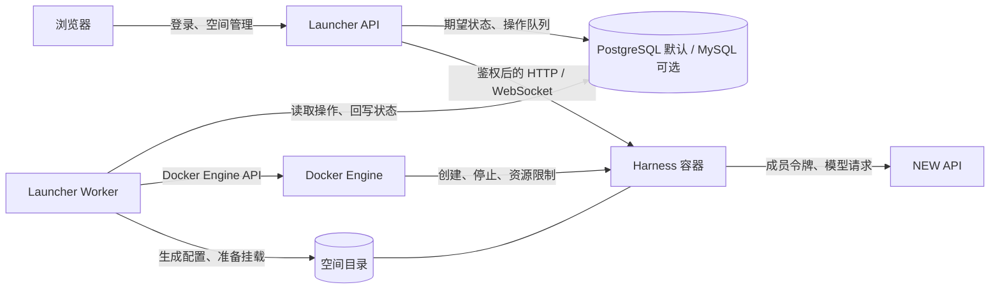
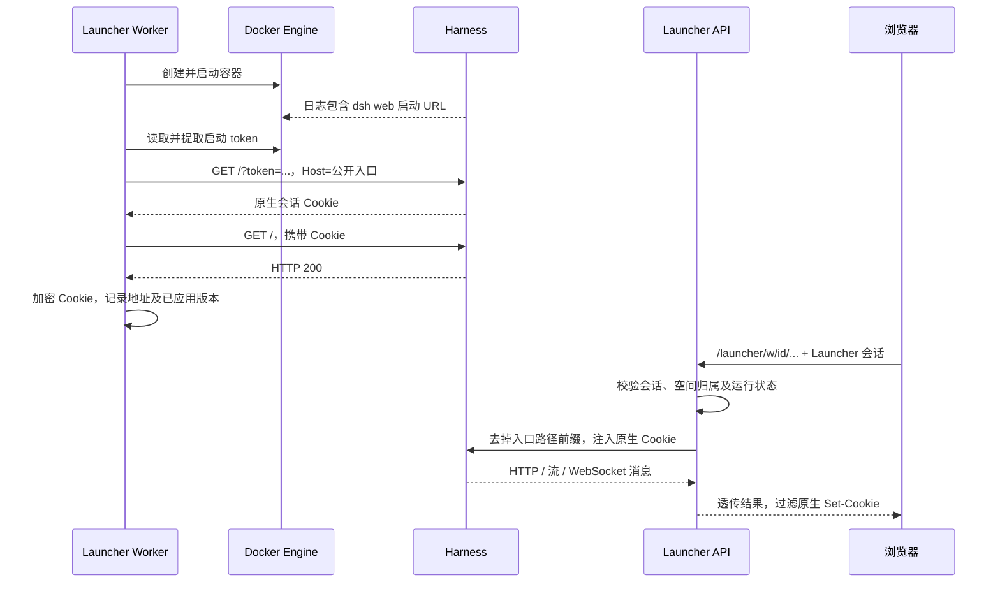

# Launcher ↔ DeepSeek Harness Docker 接口契约

文档版本：`launcher-runtime/v1`。适用于当前单宿主机、单 Worker MVP。

本文定义当前已经实现的边界和升级时需要保持的行为；最后一节单独列出尚未实现的扩展。文档版本不是镜像已经支持的协议协商字段。

适配对象为 [runzhliu/deepseek-harness-docker](https://github.com/runzhliu/deepseek-harness-docker)，参考源码提交 `d482839b469562df36e450c6146ca7afea046a7e`，镜像版本 `0.2.1-rc.2-r1`。初始化脚本固定镜像 digest，不能只凭镜像名称判断兼容性。

## 1. 职责与通信边界

| 能力 / 数据 | Launcher | Harness Docker |
|---|---|---|
| 用户登录、角色、空间归属 | 唯一管理方 | 不承担企业用户管理 |
| CPU、内存、进程数、运行名额 | 验证配额，通过 Docker 配置执行 | 在给定资源内运行 |
| 创建、启动、停止、重建 | Worker 调用 Docker Engine | 响应进程启动、终止信号 |
| 模型目录、默认模型、个人令牌 | 保存、校验、生成启动配置 | 按配置调用 NEW API |
| 模型额度和模型授权 | 展示配置，不充当计费网关 | 使用成员令牌，由 NEW API 执行限制 |
| 用户偏好、平台插件目录 | 保存并渲染配置 | 加载指令和指定插件 |
| 对话、Agent 循环、工具执行 | 代理浏览器连接，不解释消息协议 | 唯一执行方 |
| 项目文件 | 管理宿主目录、上传下载 | 在 `/workspace` 读写 |
| Harness 会话、内部配置与状态 | 整体挂载、备份，不解释内部结构 | 维护 `$DSH_HOME` 内部格式 |
| 数据库 | 默认 PostgreSQL，保留 MySQL 兼容 | 不访问 Launcher 数据库 |



边界约束：只有 Worker 挂载 Docker Socket；Harness 不获取平台数据库凭证、平台管理员凭证或其他空间目录。模型请求由 Harness 直接发往 NEW API，不经过 Launcher 的浏览器代理。

当前不要求在 Harness 中新增 `/instances`、`/users` 等管理 REST API。生命周期控制使用 Docker Engine；会话和工具请求使用 Harness 原生协议并透明代理。

## 2. 生命周期控制接口

当前内部适配器位于 [`launcher/runtime.py`](../launcher/runtime.py)，实际调用签名为：

```python
DockerRuntime.start(spec: RuntimeSpec, rebuild: bool = False) -> RuntimeHandle

DockerRuntime.recover(spec: RuntimeSpec, encrypted_cookie: str) -> RuntimeHandle

DockerRuntime.stop(workspace_id: str)
# -> None

DockerRuntime.inspect(workspace_id: str)
# -> str: Docker 容器状态，或 "missing"
```

这是 Worker 的 Python 接口，不是提供给浏览器的接口。Worker 从数据库和模板快照构建独立的 `RuntimeSpec`；Docker 适配器不接收 ORM 参数。`RuntimeHandle` 返回运行地址、加密原生 Cookie、实际镜像 ID/引用、已应用配置版本和模板版本。输入环境变量可包含兼容接入的临时凭据，对象的 repr 不输出这些变量；结果的 repr 不输出 Cookie。

| 操作 | 语义 | 成功条件 |
|---|---|---|
| `start(..., rebuild=False)` | 可复用同一配置版本的运行容器；版本不同、容器停止时重新创建 | 原生认证完成，携带原生 Cookie 访问根页返回 200 |
| `stop(id)` | 最多等待容器优雅停止 15 秒，再移除容器及专属网络 | 容器不存在；项目和 Harness home 保留 |
| `restart` | Worker 映射为 `start(..., rebuild=True)`，使用当前配置重新创建容器 | 新配置完成启动验证 |
| `rebuild` | 当前同样映射为 `start(..., rebuild=True)` | 使用配置的本地镜像重新创建，保留数据 |
| `recover(spec, cookie)` | 重新连接 API/Worker 到空间网络，复核原生 Cookie，必要时重新握手；保留原容器 | 更新实际地址、凭据和观察到的版本 |
| `inspect(id)` | 读取 Docker 实际状态 | 返回 `running`、`exited` 等 Docker 状态或 `missing` |

当前 `restart` 与 `rebuild` 的执行路径相同。它们不会执行 Dockerfile 构建，也不会自动拉取新镜像；镜像拉取由部署流程负责。

平台提供的外部操作入口是：

```text
POST <base>/api/workspaces/<id>/actions/<start|stop|restart|rebuild>
GET  <base>/api/workspaces/<id>/operations
```

提交成功返回 HTTP 202 和 Operation，代表已入队，不代表实例已就绪。一个空间最多一个活动操作；同一活动操作的重复提交返回原操作，冲突操作返回 409。操作完成之后再次提交会生成新操作，不保证无限期去重。

操作状态：`queued → running → succeeded | failed`。空间状态：`stopped → starting → running → stopping → stopped`，失败进入 `error`；连接接管暂时失败进入 `recovering` 并重试，不替换用户容器。期望状态和 Docker 实际状态分开记录。

Worker 负责租约、失败清理和状态对账。账号停用后先撤销平台访问，随后停止实例。容器意外退出会标记错误并释放名额，当前不自动反复重启失败实例。

启动和进入空间不以网关、模型或个人令牌为前置条件。配置不完整时，平台注入的团队模型提供方、默认模型和自动会话命名禁用；补充配置并重启后启用。运行名额、账号状态和空间权限校验仍然执行。

## 3. 启动输入契约

Worker 从平台配置组装以下输入，底座不需要理解 Launcher 的表结构：

| 逻辑字段 | 来源 | 传递位置 |
|---|---|---|
| `workspace_id` | 空间 ID，32 位十六进制字符串 | 容器名、网络名、目录名、Docker label |
| `image` | 空间模板快照，首次运行后固定到实际镜像 ID | Docker create 的镜像参数；不跟随全局配置改变 |
| `config_version` | 空间配置版本 | Docker label 和 `revision.json` |
| `public_url` | 平台入口 + `/w/<id>/` | CLI `--public-url` |
| `trusted_host` | 平台 URL 的 host:port | CLI `--trusted-host` |
| `gateway_base_url` | 管理员配置，含 API 前缀，例如 `/v1` | Cordis patch 的 `baseURL` |
| `models` / `default_model` | 平台目录 / 用户选择 | Cordis patch |
| `model_token` | 解密当前成员令牌；未配置时为空 | 容器环境变量，不写入 patch，不阻止进入空间 |
| `language` / `instructions` | 用户偏好 | 挂载的 `AGENTS.md` |
| `plugins` | 平台允许目录的选择 | Cordis patch 的插件启用状态 |
| `cpu` / `memory_mb` | 用户配额 | Docker CPU、内存限制 |
| 存储路径 | `DATA_ROOT/workspaces/<id>` | bind mounts |

容器名：`<docker_prefix>-<workspace_id>`；网络名：`<container_name>-net`。管理标签为：

```text
launcher.managed=<docker_prefix>
launcher.workspace=<workspace_id>
launcher.config-version=<config_version>
```

同名容器或网络的所有权标签不匹配时拒绝管理，不接管其他项目的资源。

保留镜像原始 ENTRYPOINT，Launcher 仅覆盖 CMD，参数顺序为：

```text
web
--patch /opt/deepseek-harness/web.cordis.patch.yml
--patch /run/launcher/launcher.patch.yml
--no-open
--public-url https://existing.example/launcher/w/<workspace_id>/
--trusted-host existing.example
```

`public_url` 必须包含实际路径前缀和末尾 `/`。非标准端口要包含在 `trusted_host` 中。工作目录为 `/workspace`。默认部署 UID/GID 为 `1000:1000`；非 root 本地 Worker 使用当前用户 UID/GID。

| 环境变量 | 当前值 / 含义 |
|---|---|
| `HOME` | `/workspace` |
| `DSH_HOME` | `/home/node/.dsh` |
| `LAUNCHER_MODEL_TOKEN` | 当前成员的 NEW API 推理令牌 |
| `DSH_DESKTOP_ENABLED` | `0` |
| `DSH_BROWSER_USE_ENABLED` | `0` |
| `DSH_TELEMETRY_DISABLED` | `1` |

模型令牌在 Launcher 数据库中加密，在容器创建时解密注入。环境变量可由 Docker 管理员及容器内获授权进程读取，因此它不是针对容器自身的秘密隔离机制。原始令牌不出现在前端配置响应中。

## 4. 配置文件和持久化接口

| 宿主路径（相对空间根目录） | 容器路径 | 权限 | 生命周期 |
|---|---|---|---|
| `project/` | `/workspace` | RW | 用户项目，停止和重建保留 |
| `home/` | `/home/node/.dsh` | RW | Harness 会话与内部状态，停止和重建保留 |
| `managed/` | `/run/launcher` | RO | Launcher 生成，创建容器前更新 |
| `managed/AGENTS.md` | `/home/node/.dsh/AGENTS.md` | RO | 平台渲染的个人指令 |

`managed/launcher.patch.yml` 示例（模型 ID 为占位示例）：

```yaml
- id: llm-pi-ai
  disabled: false
  config:
    providers:
      team-gateway:
        displayName: 团队 NEW API
        api: openai-completions
        baseURL: http://host.docker.internal:3000/v1
        apiKeyEnv: LAUNCHER_MODEL_TOKEN
        models:
          - id: team-model
- id: agent-default-model
  disabled: false
  config:
    provider: team-gateway
    model: team-model
- id: session-title-llm
  disabled: false
- id: ui-plugin-manager
  disabled: true
```

`managed/revision.json` 格式为 `{"version": 5}`。它是 Launcher 写出的版本记录；当前不是 Harness 回传的确认文件。`applied_version` 由 Worker 完成启动认证后记录。

上面的 patch 示例适用于已配置完整模型连接的空间。网关、可选模型或令牌缺失时，前三项的 `disabled` 为 `true`；这仍是可启动、可进入的有效运行配置。

模板新版本发布不会改变已有空间。空间显式切换模板时保存新快照、清除待运行镜像固定值并递增配置版本；已有运行版本在重启前继续工作。兼容组不同的模板不能复用现有空间；组名是管理员声明，发布前必须自行验证镜像数据兼容性。

保存设置只递增 `config_version`，不热修改运行中的容器。重启或重建时应用新版本；平台网关和模型目录变更也会使所有空间配置版本递增。旧实例在重启前继续使用旧地址和配置。

插件字段是平台目录 ID，不接受任意 npm 包名或挂载路径。当前仅 `session-titles` 可切换，对应底座 `session-title-llm`；文件、Shell、个人指令是固定能力。关闭原生插件管理界面是产品边界，不等于阻止拥有 Shell 能力的进程安装代码。

资源约束包括只读根文件系统、可写且限额的 `/tmp`、CPU/内存/PID 限制、移除 capabilities 和 `no-new-privileges`。存储容量目前是用量提示阈值，不是磁盘硬配额。Launcher 负责目录生命周期，Harness 不负责删除空间；当前没有彻底删除空间的数据销毁接口。

## 5. Web 认证与代理接口

容器网络入口为 TCP 3080。底座内原生服务监听 loopback，镜像入口脚本启动 relay，将具体容器接口转发到原生服务。Launcher 必须保留此 ENTRYPOINT 行为。

启动认证时序：



当前认证提取依赖日志中的 `dsh web: <URL>` 格式，这是固定版本适配，不是上游承诺的长期稳定 API。不得将包含 token 的原始日志、启动 URL 或原生 Cookie 暴露给浏览器或通用审计日志。

浏览器入口：`<base>/w/<workspace_id>/<native_path>`；上游目标：`<runtime_address>/<native_path>`。只移除外部空间前缀，保留原生路径、查询参数和请求体；Launcher 不枚举或改写 Harness 的会话消息结构。

HTTP 代理剔除浏览器的 Launcher Cookie、Authorization、CSRF 和转发头，注入该空间的原生 Cookie，并使用公开入口的 Host。过滤上游 Set-Cookie、带启动 token 的重定向及外部绝对重定向；内部相对根路径重定向映射回空间前缀。浏览器 HTTP 入口拒绝 `token` 查询参数。

WebSocket 使用同一空间鉴权，校验 Origin，转发文本/二进制消息并协商子协议。平台 HTTP 流约每 3 秒、WebSocket 约每 2 秒复核权限，账号停用、会话撤销后中断连接。

管理员的资源管理权限不授予其他成员的空间内容访问权。所有空间共享浏览器 origin，当前仅承载受控 Harness 前端，不承诺任意用户 HTML/JavaScript 的来源隔离。

## 6. 网络、模型调用与健康状态

每空间一个独立 bridge 网络；Compose 中 API 和 Worker 加入该网络，直接访问容器 IP:3080。直接在宿主运行 Launcher 时，实例端口仅映射到宿主 loopback 的随机端口。容器 IP 是临时地址，重建后重新发现，不作为持久身份。

网络允许 Harness 出站访问 NEW API。网关地址必须同时从平台 API 和 Harness 容器可达，不能只验证浏览器或宿主机可达。Docker Desktop 同机网关可以使用 `http://host.docker.internal:3000/v1`；这是环境相关地址，不是适用于所有 Linux Docker Engine 部署的固定默认值。

| 检查层次 | 检查内容 | 当前实现 / 限制 |
|---|---|---|
| 进程状态 | 容器是否运行 | `inspect`；不等于应用健康 |
| Web 就绪 | 原生认证后根页是否 200 | 启动流程执行；不是完整会话调用测试 |
| 网关可达、令牌有效、模型可见 | GET `<gateway>/models` | 平台 `test-model` 从 API 容器执行，不覆盖 Harness 网络路径 |
| 模型实际可调用 | 完成最小流式推理 | 按需验收，不是常驻健康检查，也不是启动的自动前置条件 |

因此 `Workspace.status=running` 只表示空间已完成启动，不能表示模型一定可用。模型请求连接超时、401、429 或上游 5xx 不应直接当成容器故障反复重建。

当前相关超时：Docker 客户端 20 秒；启动就绪等待默认 120 秒；就绪 HTTP 单次 4 秒；停止优雅等待 15 秒；平台模型列表检查 15 秒；Web HTTP 代理连接等超时 30 秒、响应流读取无固定超时。实际模型请求的超时由 Harness 模型适配器和 NEW API 决定，当前 Launcher 不提供统一的模型请求超时配置。

## 7. 版本兼容与验收

升级底座前必须验证：CLI 参数、环境变量、patch 路径和插件 ID、3080 relay、原生认证交换、路径前缀和 WebSocket、数据目录兼容性。镜像版本和用户配置版本是两个维度，不能混用。

按固定 digest 验证后再替换镜像；升级前停止并备份空间，未知的数据格式迁移不能仅通过换回旧镜像回滚。底座内部会话文件结构不属于 Launcher 的稳定接口。

验收基线：

1. 同一配置重复启动不产生重复实例；同名外部资源不得接管。
2. 启动后能通过带路径前缀的入口使用原生 UI、HTTP 流和 WebSocket。
3. 原生凭据不下发浏览器；越权空间访问被拒绝；会话撤销中断长连接。
4. 停止、启动、重建后项目和 Harness home 内容保留。
5. 更新模型、令牌、偏好、插件后，重启应用新版本。
6. 从实例中能访问测试网关，完成流式响应和文件/Shell 工具执行。
7. 失败释放运行名额，保留数据，支持重新提交操作。

对应验证入口：`tests/test_api.py`、`tests/test_proxy.py`、`tests/test_worker.py`、`scripts/smoke.py`、`scripts/runtime-browser.mjs`。数据库默认选择和 MySQL 兼容性不改变这份运行时接口。

## 8. 模板与维护接口

```text
GET   <base>/api/admin/templates
POST  <base>/api/admin/templates                    创建草稿，镜像必须带 sha256 digest
PUT   <base>/api/admin/templates/<id>               修改未发布草稿
POST  <base>/api/admin/templates/<id>/publish       发布；版本内容随后不可变
PATCH <base>/api/admin/templates/<id>               启用/停用，不影响已有空间快照
PUT   <base>/api/workspaces/<id>/template           保存期望模板，expected_version 防止覆盖
PUT   <base>/api/workspaces/<id>/maintenance        max_runtime_minutes，null 表示不限时
POST  <base>/api/admin/workspaces/<id>/upgrade      指定模板并入队重建
POST  <base>/api/admin/workspaces/actions           批量 start/stop/restart，逐项返回结果
```

模板 `spec` 定义接口版本、数据兼容组、CPU/内存默认值、临时目录限额、公开环境变量和镜像 `/opt` 内的启动补丁。固定 `persistent-project-home` 挂载布局，不接受任意宿主目录。实际 CPU 和内存取模板默认值与成员配额的较小值。保留环境变量不可覆盖，模板中不填写秘密。

`RuntimeTemplate` 保存模板版本；`WorkspaceRuntime` 保存空间快照、应用快照、固定镜像 ID、实际镜像、接管时间及到期策略。新增表及旧空间补齐在初始化时幂等执行，旧空间/用户表不修改。初始内置模板来自 `LAUNCHER_RUNTIME_IMAGE`；之后修改全局镜像配置不更新已保存模板。

Worker 约每 10 秒重新检查运行空间的代理连接。临时接管失败保留运行名额并自动重试；容器已退出则标记错误。Worker 仅清理带本平台标签且空间 ID 已不存在的容器和网络，及期望停止空间的残留运行资源；从不清理项目和 home 数据。

到期策略按每次启动/重启开始计时；更新运行中策略从保存时重新计时；平台重启和恢复连接不延长截止时间。到期生成正常停止操作并审计，可能中断正在执行的任务。批量操作逐项执行、逐项报告冲突和容量限制，不承诺整批原子成功。

## 9. 后续底座协作边界

下一步可与 Docker 底座约定机器可读的兼容元数据和受限认证握手，替代当前启动日志解析；当前镜像尚未提供该机制。Launcher 只维护进程、启动认证、代理网络和环境配置。模型调用、推理探测及 AI 故障诊断由 Harness 插件承担，不纳入 Launcher 运行时探测协议。

外部身份绑定和授权提供方待具体接入方出现后再扩展，当前不假定对端授权协议，也不增加网关管理凭据下发。
